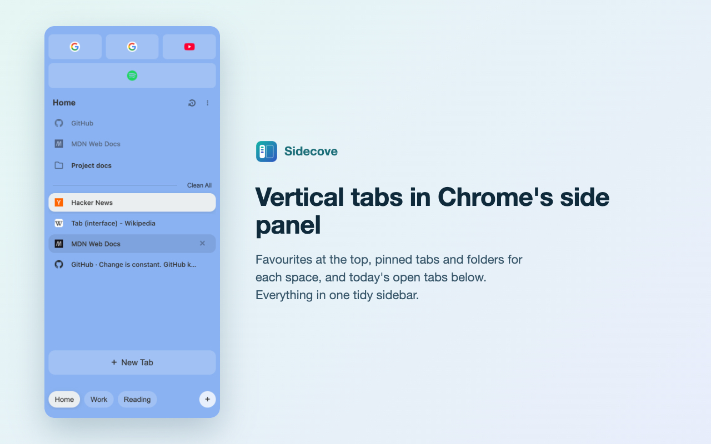
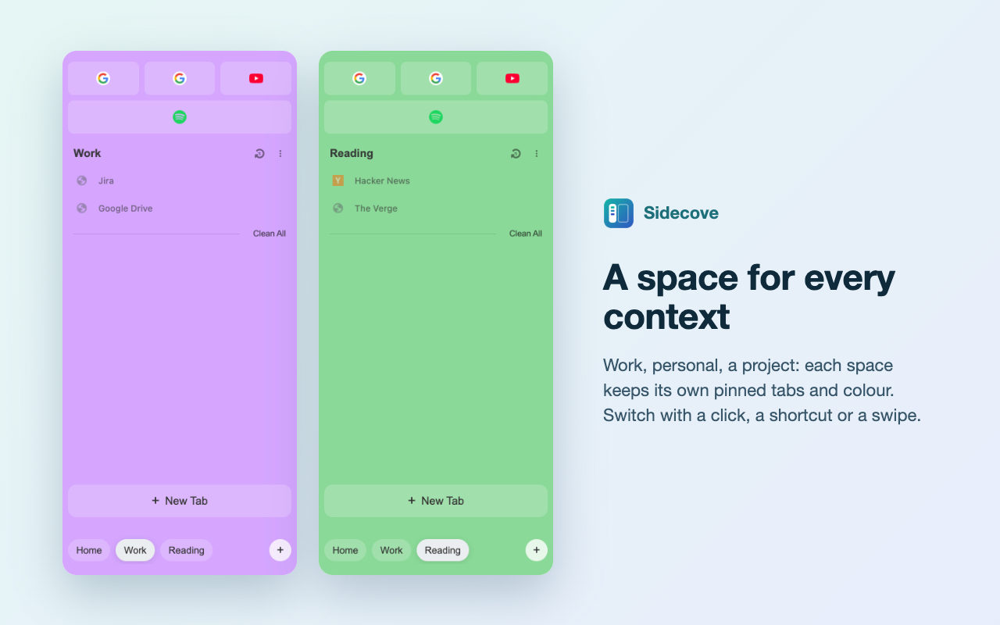

# Sidecove: vertical tabs, spaces and pinned tabs for Chrome

Sidecove puts your tabs in a vertical sidebar in Chrome's side panel and organises them into spaces, each with its own pinned tabs, folders and colour. Spaces and pinned tabs are stored as ordinary Chrome bookmarks, so they sync with your Google account. Nothing is sent to any server.

Sidecove is an independent project, not affiliated with or endorsed by The Browser Company or the Arc browser.

## Features

- Vertical tabs in Chrome's side panel, organised into spaces with their own colour and icon
- Pinned tabs, favorites and nested folders, stored as ordinary Chrome bookmarks
- Drag tabs, favorites and folders between sections, folders and spaces; drop one tab on a favorite to make a folder
- Multi-select with Cmd or Ctrl click and Shift click to move, pin, archive, close or file several tabs at once
- Search open tabs and favorites across spaces (Cmd or Ctrl+F)
- Keyboard and mouse side-button space switching
- Auto-archive for idle tabs, and Clean All with Undo

See [CHANGELOG.md](CHANGELOG.md) for what changed in each version.

## Install

1. Download `sidecove-extension.zip` from the latest [GitHub release](https://github.com/matthewmoorcroft/sidecove/releases/latest) and unzip it.
2. Open `chrome://extensions/` and turn on **Developer mode** (top right).
3. Click **Load unpacked** and choose the unzipped folder.

To update, unzip the new release over the same folder and click the reload icon on the Sidecove card in `chrome://extensions/`. Chrome identifies an unpacked extension by its folder, so loading a copy from a new folder starts with empty spaces and settings.

Sidecove needs Chrome 116 or later, for the side panel features it uses.

## Issues and Feature Requests

We use GitHub Issues to track bugs and feature requests. Before creating a new issue:

1. Search existing issues to avoid duplicates
2. Use our issue templates when available

### Reporting Bugs 🐛

1. Go to the [Issues](https://github.com/matthewmoorcroft/sidecove/issues) page
2. Click "New Issue"
3. Choose "Bug Report" template if available
4. Include:
   - Clear description of the bug
   - Steps to reproduce
   - Expected vs actual behavior
   - Browser version and OS
   - Screenshots if applicable

### Feature Requests 💡

1. Go to the [Issues](https://github.com/matthewmoorcroft/sidecove/issues) page
2. Click "New Issue"
3. Choose "Feature Request" template if available
4. Include:
   - Clear description of the feature
   - Use cases
   - Potential implementation ideas (optional)
   - Mock-ups or examples (if applicable)

## Contributing

Contributions are welcome. [CONTRIBUTING.md](CONTRIBUTING.md) covers setting up, building, testing and opening a pull request.

## License

This project is licensed under the GNU General Public License v3.0 - see the [LICENSE](LICENSE) file for details.

### What this means:

- You can freely use, modify, and distribute this software
- If you modify and distribute this software, you must:
  - Make your modifications available under the GPL
  - Include the original copyright notice
  - Provide access to the source code
  - Include the full license text

## Contact

If you have any questions or suggestions, please open an issue on GitHub.

## Privacy

Sidecove reads your tabs' titles and URLs only to show and manage them in the sidebar. Spaces and pinned tabs are kept in Chrome bookmarks and settings in `chrome.storage`, which Chrome may sync through your Google account. Nothing is sent anywhere else: there are no analytics, no tracking and no third parties. See [PRIVACY.md](PRIVACY.md).

## Acknowledgments

- The sidebar, spaces and pinned-tab workflow was inspired by the Arc browser. Arc is a trademark of The Browser Company; Sidecove is not affiliated with it.
- Thanks to all contributors who help improve this project

### Independent spaces

Spaces and their tab order are stored by the extension, independently of Chrome tab
groups. Closing the last tab keeps the space and its bookmarks. Moving, renaming,
recoloring, or removing a native group does not change a space. The background
service worker tracks new and closed tabs even when the sidebar is closed; new
tabs inherit their opener's space, or the active space for their window. A window
with no space yet, such as one Chrome opens for a link from another app, uses the
space you used last.

Existing spaces from earlier versions migrate automatically to stable IDs. On a fresh setup with
native groups, the sidebar offers an optional **Create spaces** import; declining
leaves those groups alone. Import copies group names, colors, and current members.

**Settings → Sync Spaces to Chrome Tab Groups** is off by default. Enabling it
mirrors extension membership, names, colors, and order into per-window groups.
Extension data remains authoritative, so native group edits are overwritten while
sync is enabled. Disabling it leaves the current native groups unchanged.

Chrome tab IDs change across browser sessions. Live IDs are kept in extension
storage during a session; after a browser restart, saved URL records reconnect
restored tabs and recover space order. Identical URLs in different spaces are
matched in saved occurrence order because Chrome does not expose a durable tab ID.
Space definitions and bookmarks remain available even when tabs are not restored.

Pinned tabs are backed by bookmarks in **Sidecove → space name**, regardless of the
tab-group sync setting. Startup and opening the sidebar discover existing space
folders, including folders synced by Chrome, and display their bookmarks as saved
pins. Pinning adds a bookmark; unpinning removes its saved bookmark even if the tab
has navigated to another URL. After removing a favorite, the brief Undo prompt can
restore its bookmark in the same folder and position, and an unpinned tab that is still
open becomes that favorite's tab again. **Move to Space** on a pinned tab, open or unloaded,
moves its bookmark into the target space's folder and keeps it pinned. Nested bookmark folders remain nested in the space.
Deleting a space also deletes its bookmark folder and all bookmarks inside it.

Space chips follow the order of the space folders under **Sidecove**: moving a folder
in Chrome's bookmark manager reorders the chips, and dragging a chip moves its
folder. On the first load after updating, space order follows the bookmark folder
order, so a chip order set by dragging before this change resets once; dragging
chips afterwards moves the folders and the order sticks.

With **Sync spaces to Chrome tab groups** off, right-click a folder and choose **New Folder** to create a child folder. Spaces support up to four folder levels. Turning sync on disables new nested-folder creation and preserves existing folders.

Right-click a folder and choose **Move Up** or **Move Down** to swap it with the item shown above or below it within its space or parent folder. Each option is hidden when the folder has no neighbor in that direction.

Drag a folder by its header to reorder it among its siblings, move it to the space's top level, or drop it into an open folder's content to nest it. A folder cannot be dropped into itself or its own subfolders. Nesting by drag follows the same rules as **New Folder**: sync must be off, and the result must stay within four folder levels; a folder that contains subfolders can only be reordered or moved to the space's top level. Reordering within the folder's current parent works in either sync mode.
